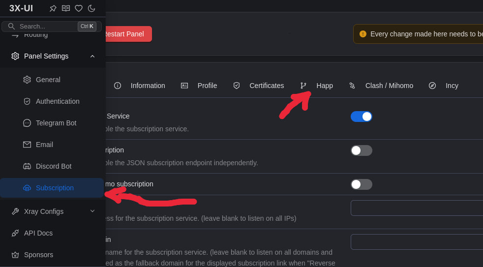
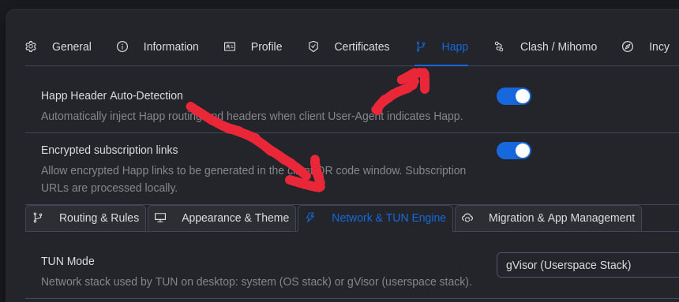
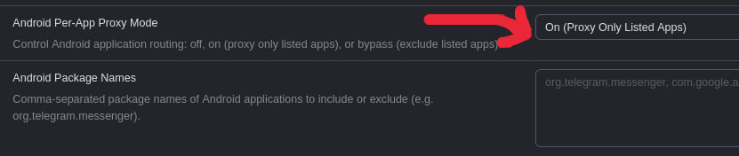
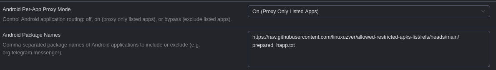
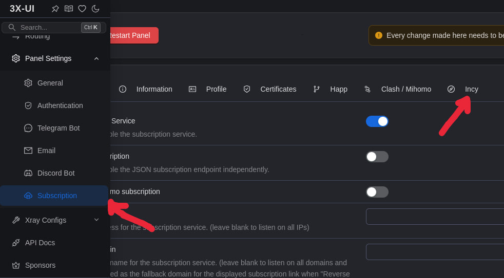
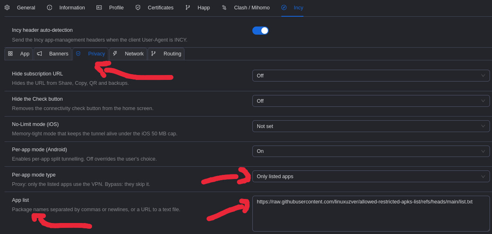

# Allowed restricted apks list

This repo create for 3X-UI panel Subscription settings by https://github.com/MHSanaei/3x-ui project.

# How to apply list

## Happ

In this screenshot we have 3X-UI interface and we should go to **Subscription** in Burger menu, then go to **Happ**.

After going to, go to **Network & TUN engine** tab and scroll down to **Android Package Names** and set **Android Per-App Proxy Mode** to **On (Proxy Only Listed Apps)**.

After that, paste the link to **Android Package Names** https://raw.githubusercontent.com/linuxuzver/allowed-restricted-apks-list/refs/heads/main/prepared_happ.txt link.

> [!NOTE]
> I have not tested yet, but if you encountered an errors or something, just copy & paste **prepared_happ.txt** contents directly to prompt.

## Incy

In this screenshot go to **Incy** tab.

After going to, go to **Privacy** tab and scroll down to **App list**, set **Per-app mode type** to **Only listed apps** and paste
https://raw.githubusercontent.com/linuxuzver/allowed-restricted-apks-list/refs/heads/main/list.txt to prompt.

# Contribution

## Happ

Update **list.txt** with **./PREPARE_HAPP** script, then it will update to comma-separated file **prepared_happ.txt**.

## Incy

Just edit **list.txt** and pull request changes.
